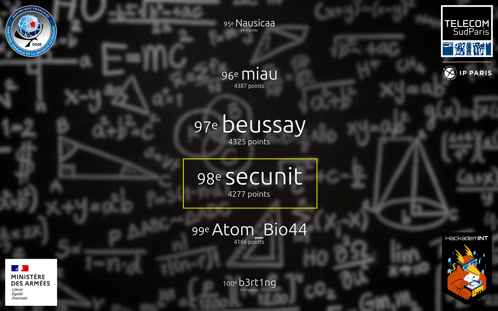

+++
date = '2026-08-20T08:53:19+02:00'
draft = true
title = '404CTF 2026'

[menus.main]
  name = "404CTF 2026"
  weight = 30
  parent = "404CTF"
+++

#### 404CTF, c'est quoi ?

L'événement 404CTF est une compétition organisée par la DGSE (Direction générale de la sécurité extérieure). La compétition se déroule sur 3 semaines.

C'est une compétition de type "Jeopardy", ce qui signifie qu'il y a plein de catégories différentes (crypto, pwn, réaliste, ...).

#### Résultat

404CTF propose un classement individuel. J'ai fini 98e sur environ 2 300 participants (2 000 si on ne compte que ceux qui ont des points). C'est un classement dont je suis assez content, même si j'aurais clairement pu récupérer d'autres points dans la catégorie réaliste (ma catégorie préférée).

