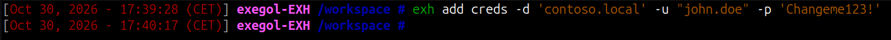
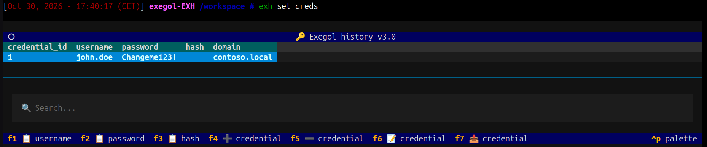
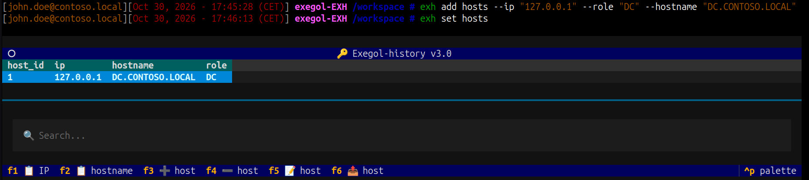
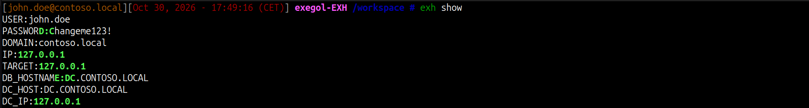
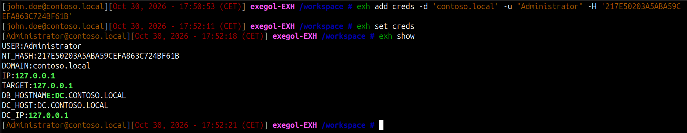

+++
date = '2026-10-30T09:25:00+01:00'
draft = true
title = 'Exegol-history'

[menus.main]
  name = "Exegol-history"
  weight = 30
  parent = "Blog"
+++

### Contexte

Si vous avez lu le premier write-up que j'ai publié sur la machine `Checkpoint` de Hack The Box (dispo [ici](https://secunit.me/challenges/hackthebox/checkpoint/)), vous avez sûrement remarqué, en préambule, l'utilisation du tool `exegol-history` (alias `exh`) qui fait partie de l'environnement `Exegol`.

L'idée globale, c'est que cet outil va vous permettre de définir facilement des variables d'environnement concernant des utilisateurs, des mots de passe, des IP, des domaines, etc.

Ces variables d'environnement vont pouvoir être utilisées en CLI avec vos tools habituels. Ainsi, l'utilisation d'`exegol-history` rend vos commandes agnostiques des valeurs des variables d'environnement créées par `exegol-history`.

Le gros point fort de ce tool, c'est son utilisation dans un environnement AD, où vous pourrez switcher d'un utilisateur du domaine à un autre facilement, en une seule ligne de commande.

À travers cet article, mon but est de vous montrer comment j'utilise ce tool et comment il me fait gagner un temps précieux.

### Référence

Si vous avez des questions concernant les commandes basiques, vous pourrez peut-être trouver votre bonheur [ici](https://docs.exegol.com/images/exegol-history).

Le repo GitHub du tool est disponible à l'adresse suivante :

- https://github.com/ThePorgs/Exegol-history

Ceci étant dit, nous pouvons passer à la démonstration.

### Usage

`exegol-history` (alias `exh` dans l'environnement `Exegol`) s'utilise principalement avec deux modules : `creds` et `hosts`.

Le module `creds` va concerner les variables d'environnement liées aux comptes utilisateurs, donc `username`, `password`, `hash`, `domain` (le `hash` fait principalement référence au hash NT).

Le module `hosts` va concerner toutes les variables d'environnement liées à la machine cible : `ip`, `hostname`, `role`. Le rôle fait notamment référence au rôle de la machine dans le cas où celle-ci est un `DC`, auquel cas vous aurez accès aux variables `dc_host` et `dc_ip`.

Vous pouvez ainsi ajouter, supprimer ou sélectionner vos groupes de variables d'environnement.

Vous pouvez également importer/exporter des variables au format `.json` ou `.csv` (ceci ne sera pas traité sur cette page).

### Exemple



Ici, j'ai ajouté un groupe de variables d'environnement. Pour utiliser ce groupe de variables d'environnement, il faut le sélectionner :



Il suffit d'appuyer sur Entrée et le tour est joué.

À savoir, on peut effectuer toutes les actions citées plus haut directement depuis la GUI accessible avec le module `set` (voir la commande `F?` en bas du screen).

De même, on peut réaliser les mêmes actions pour le groupe de variables `hosts`.



On remarque que le prompt est précédé, en début de ligne, des variables `username` et `domain` définies avec `creds` une fois qu'on les a sélectionnées.

À tout moment, on peut avoir un résumé des variables d'environnement à disposition avec la commande `exh show`.



Le gros point fort, c'est que si l'on récupère plusieurs comptes utilisateurs ou plusieurs machines cibles, on peut passer de l'un à l'autre facilement.



Ici, j'ai ajouté le compte `Administrator`, non pas avec un mot de passe, mais avec un hash pour montrer un autre cas de figure (principalement pour les attaques `Pass-the-hash` ou `Overpass-the-hash`).

Concernant l'utilisation dans vos tools préférés, voici quelques lignes de commande facilement réutilisables à l'identique, mais qui produiront des résultats différents en fonction des variables d'environnement sélectionnées.

```zsh
evil-winrm-py --ip "$TARGET" --user "$USER" --kerberos --no-pass

smbclientng -d "$DOMAIN" -u "$USER" -p "$PASSWORD" --host "$DC_IP"

nxc smb "$TARGET" -u "$USER" -p "$PASSWORD"

bloodyAD --host "$DC_IP" -d "$DOMAIN" -u "$USER" -p "$PASSWORD" get object $TargetObject --attr msDS-ManagedPassword

xfreerdp /d:"$DOMAIN" /u:"$USER" /pth:"$NT_HASH" /v:"$TARGET" /cert-ignore /drive:WORKSPACE,/workspace /drive:TOOLS,/opt/resources/windows /dynamic-resolution

psexec.py -hashes :"$NT_HASH" "$DOMAIN"/"$USER"@"$TARGET"

...
```

C'est tout pour cet article. Je ne pense pas qu'il soit réellement nécessaire de l'alourdir. Je n'ai pas couvert toutes les configurations possibles, mais au moins les fonctionnalités que j'utilise le plus.

Done !